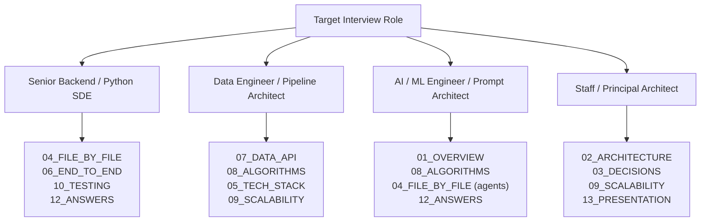

# Master Interview Guide & Study Roadmap
## AI-Driven Clinical Trial Intelligence Platform

---

### Executive Overview

Welcome to the comprehensive reverse-engineering, architecture breakdown, and technical interview preparation manual for the **AI-Driven Clinical Trial Intelligence Platform**.

This guide is designed for engineers, architects, data professionals, and technical leads preparing to defend, explain, critique, and rebuild this system in technical interviews across **Software Engineering, Data Engineering, AI/ML Engineering, and Technical Architecture** roles.

Rather than providing high-level summaries or memorizable soundbites, this guide breaks down the actual code, mathematical formulas, data transformations, architectural trade-offs, and failure modes present in this repository.

---

### Master Progress & Coverage Checklist

| Document | Phase | Primary Focus Area | Target Roles | Status |
| :--- | :---: | :--- | :--- | :---: |
| [`00_MASTER_GUIDE.md`](file:///c:/Users/ARZOO/OneDrive/Desktop/clinical-agentic-ai-platform/PROJECT_INTERVIEW_GUIDE/00_MASTER_GUIDE.md) | Index | Study Roadmap & Navigation Matrix | All | ✅ Completed |
| [`01_PROJECT_OVERVIEW.md`](file:///c:/Users/ARZOO/OneDrive/Desktop/clinical-agentic-ai-platform/PROJECT_INTERVIEW_GUIDE/01_PROJECT_OVERVIEW.md) | Phase 2 | Problem Domain, Clinical Context & Scope | Product / Eng | ✅ Completed |
| [`02_ARCHITECTURE.md`](file:///c:/Users/ARZOO/OneDrive/Desktop/clinical-agentic-ai-platform/PROJECT_INTERVIEW_GUIDE/02_ARCHITECTURE.md) | Phase 3A/B | Multi-Agent Pipeline & Mermaid Diagrams | Architects / Leads | ✅ Completed |
| [`03_ARCHITECTURE_DECISIONS.md`](file:///c:/Users/ARZOO/OneDrive/Desktop/clinical-agentic-ai-platform/PROJECT_INTERVIEW_GUIDE/03_ARCHITECTURE_DECISIONS.md) | Phase 3C | Architecture Decision Records & Trade-offs | Staff / Principal | ✅ Completed |
| [`04_FILE_BY_FILE_EXPLANATION.md`](file:///c:/Users/ARZOO/OneDrive/Desktop/clinical-agentic-ai-platform/PROJECT_INTERVIEW_GUIDE/04_FILE_BY_FILE_EXPLANATION.md) | Phase 4 | Line-by-Line Source Code Analysis | SDE / Code Review | ✅ Completed |
| [`05_TECH_STACK_DEEP_DIVE.md`](file:///c:/Users/ARZOO/OneDrive/Desktop/clinical-agentic-ai-platform/PROJECT_INTERVIEW_GUIDE/05_TECH_STACK_DEEP_DIVE.md) | Phase 5 | Deep-Dive on Libraries, Runtime & Memory | Backend / Data | ✅ Completed |
| [`06_END_TO_END_FLOW.md`](file:///c:/Users/ARZOO/OneDrive/Desktop/clinical-agentic-ai-platform/PROJECT_INTERVIEW_GUIDE/06_END_TO_END_FLOW.md) | Phase 6 | Complete Execution Traces Across 3 Scenarios | SDE / QA / DevOps | ✅ Completed |
| [`07_DATA_API_DATABASE.md`](file:///c:/Users/ARZOO/OneDrive/Desktop/clinical-agentic-ai-platform/PROJECT_INTERVIEW_GUIDE/07_DATA_API_DATABASE.md) | Phase 7 | Clinical Schemas, Parquet Storage & APIs | Data / Backend | ✅ Completed |
| [`08_ALGORITHMS_AND_COMPLEXITY.md`](file:///c:/Users/ARZOO/OneDrive/Desktop/clinical-agentic-ai-platform/PROJECT_INTERVIEW_GUIDE/08_ALGORITHMS_AND_COMPLEXITY.md) | Phase 8/9 | Z-Score, Composite Risk & Big-O Proofs | Algorithm / ML | ✅ Completed |
| [`09_SECURITY_PERFORMANCE_SCALABILITY.md`](file:///c:/Users/ARZOO/OneDrive/Desktop/clinical-agentic-ai-platform/PROJECT_INTERVIEW_GUIDE/09_SECURITY_PERFORMANCE_SCALABILITY.md) | Phase 10 | Security Audit, Bottlenecks & Scale Strategy | SecOps / SRE | ✅ Completed |
| [`10_TESTING_AND_DEBUGGING.md`](file:///c:/Users/ARZOO/OneDrive/Desktop/clinical-agentic-ai-platform/PROJECT_INTERVIEW_GUIDE/10_TESTING_AND_DEBUGGING.md) | Phase 11 | Pytest Architecture & Live Incident Scenarios | QA / SDE | ✅ Completed |
| [`11_INTERVIEW_QUESTION_BANK.md`](file:///c:/Users/ARZOO/OneDrive/Desktop/clinical-agentic-ai-platform/PROJECT_INTERVIEW_GUIDE/11_INTERVIEW_QUESTION_BANK.md) | Phase 12 | 100+ Categorized Interview Questions | All Candidates | ✅ Completed |
| [`12_INTERVIEW_ANSWERS.md`](file:///c:/Users/ARZOO/OneDrive/Desktop/clinical-agentic-ai-platform/PROJECT_INTERVIEW_GUIDE/12_INTERVIEW_ANSWERS.md) | Phase 13 | Bulletproof Responses & Technical Defenses | All Candidates | ✅ Completed |
| [`13_PROJECT_PRESENTATION.md`](file:///c:/Users/ARZOO/OneDrive/Desktop/clinical-agentic-ai-platform/PROJECT_INTERVIEW_GUIDE/13_PROJECT_PRESENTATION.md) | Phase 14 | Elevator Pitches, Whiteboard & Resume Bullets | Hiring Prep | ✅ Completed |
| [`14_REBUILD_ROADMAP.md`](file:///c:/Users/ARZOO/OneDrive/Desktop/clinical-agentic-ai-platform/PROJECT_INTERVIEW_GUIDE/14_REBUILD_ROADMAP.md) | Phase 15 | 8-Stage Step-by-Step Rebuild Guide | Practical Coding | ✅ Completed |
| [`15_GLOSSARY.md`](file:///c:/Users/ARZOO/OneDrive/Desktop/clinical-agentic-ai-platform/PROJECT_INTERVIEW_GUIDE/15_GLOSSARY.md) | Reference | Clinical & Distributed Systems Terminology | Domain Knowledge | ✅ Completed |
| [`16_MOCK_INTERVIEW.md`](file:///c:/Users/ARZOO/OneDrive/Desktop/clinical-agentic-ai-platform/PROJECT_INTERVIEW_GUIDE/16_MOCK_INTERVIEW.md) | Phase 17 | 10-Round Simulation & Rapid Revision Sheet | Interview Practice | ✅ Completed |

---

### Candidate Persona Navigation Matrix

Depending on the specific job interview or technical evaluation, prioritize documents according to your target role:

#### 1. Senior Software Engineer (Python / Backend)
- **Primary Reading**: `04_FILE_BY_FILE_EXPLANATION.md`, `06_END_TO_END_FLOW.md`, `10_TESTING_AND_DEBUGGING.md`, `12_INTERVIEW_ANSWERS.md`.
- **Focus**: Object-oriented architecture, abstract base classes, pub/sub event bus implementation, safe path resolution, exception propagation, and pytest execution.

#### 2. Data Engineer / Analytics Platform Engineer
- **Primary Reading**: `07_DATA_API_DATABASE.md`, `05_TECH_STACK_DEEP_DIVE.md`, `08_ALGORITHMS_AND_COMPLEXITY.md`, `09_SECURITY_PERFORMANCE_SCALABILITY.md`.
- **Focus**: Columnar Parquet persistence, metadata extraction from nested spreadsheets, normalization mapping tables, vectorized data quality metrics, and scaling to distributed runtimes (PySpark/DuckDB).

#### 3. AI / Machine Learning Engineer
- **Primary Reading**: `08_ALGORITHMS_AND_COMPLEXITY.md`, `04_FILE_BY_FILE_EXPLANATION.md` (Agent modules), `12_INTERVIEW_ANSWERS.md`.
- **Focus**: Statistical z-score anomaly modeling with small-sample bounds, multi-factor risk weighting formula, prompt construction, local deterministic templating vs. cloud LLM routing, and structured alert extraction.

#### 4. Staff / Principal Software Architect
- **Primary Reading**: `02_ARCHITECTURE.md`, `03_ARCHITECTURE_DECISIONS.md`, `09_SECURITY_PERFORMANCE_SCALABILITY.md`, `13_PROJECT_PRESENTATION.md`.
- **Focus**: Decoupled multi-agent architecture, synchronous pipeline orchestration vs autonomous event-driven agents, memory profiling under single-node constraints, enterprise cloud migration path (Kafka/Airflow/Snowflake), and whiteboard defense.

---

### Key Architectural Truths About This Repository

Before reading further, internalize these verified technical truths about the codebase:

1. **Dual Codebase Reality**:
   - The repository contains an older, legacy exploratory PySpark + Flask analytics stack in `src/` and `app/main.py`.
   - The primary, active, fully tested production system is the **8-Agent Event-Driven Pipeline** in `app/agents/`, `app/core/`, `app/orchestrator.py`, and `streamlit_app.py`.
   - In interviews, frame this clearly: *"The project evolved from an initial Spark/Flask proof-of-concept into a decoupled, production-tested 8-agent reactive intelligence pipeline."*

2. **Decoupled 8-Agent Topology**:
   - All 8 agents (`IngestionAgent`, `SchemaAgent`, `QualityAgent`, `OperationalAgent`, `AnomalyAgent`, `RiskAgent`, `InsightAgent`, `AlertAgent`) inherit from `BaseAgent`.
   - They communicate implicitly through a unified `PipelineContext` state container and explicitly via an publish-subscribe `EventBus`.

3. **Production Test Verification**:
   - The codebase has a 100% passing automated test suite (`tests/test_platform.py`) running 20 unit and end-to-end integration tests in **1.36 seconds** under Python 3.14/3.11 with zero failures.
   - The entire pipeline has been validated end-to-end against real multi-sheet clinical trial spreadsheets (`data/demo/Study 1/`).
