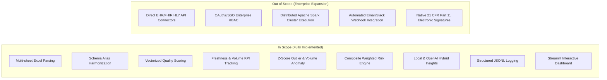

# Phase 2: Project Overview & Clinical Domain Context

---

## 1. What the Project Does

### In Simple Language (Non-Technical Explanation)
Imagine a global pharmaceutical company testing a new cancer medication across 50 hospitals in 10 countries. Each hospital uses different software systems, sends spreadsheets with completely different column names, forgets to submit data on time, or makes data-entry mistakes (like entering patient numbers twice or submitting zero patient visits). 

Normally, human data managers must manually open dozens of messy Excel sheets every week, compare them, calculate risk scores by hand, write emails to hospital sites, and search for severe medical events.

This platform automates that entire process using an **AI-driven team of 8 specialized software "agents"**:
1. It ingests messy Excel files (or uploaded ZIP archives).
2. It automatically translates inconsistent column names into a clean, uniform language.
3. It checks for missing values, duplicates, and statistical outliers.
4. It tracks hospital operational performance (e.g., whether submissions are overdue).
5. It flags anomalies (such as sudden unexplained spikes in patient enrollment).
6. It computes a mathematically balanced **Risk Score** for each site and study.
7. It writes clear, human-readable explanations of *why* something went wrong.
8. It generates prioritized alerts with concrete recommended actions for medical monitors to investigate.

### In Engineering Language (Technical Specification)
The platform is an **event-driven, modular multi-agent data intelligence and quality monitoring pipeline** designed for heterogeneous clinical trial data. It ingests semi-structured multi-sheet workbooks (Rave EDC, CPID metrics, EDRR query backlogs, SAE safety dashboards, MedDRA/WHODD coding logs, visit projection trackers), applies canonical schema mapping through alias dictionaries, performs vectorized data quality evaluations (completeness, duplicate cardinality, and z-score outlier detection), evaluates operational freshness KPIs, detects volume shift anomalies using sample-bounded z-score distributions, calculates multi-criteria weighted risk indices ($0-100$), generates natural language diagnostics via a pluggable LLM interface (offline deterministic templating or modern OpenAI client), and dispatches structured alerts persisted into append-only JSONL event logs and an interactive Streamlit executive dashboard.

---

## 2. The Real-World Problem It Solves

### The Clinical Data Silo Dilemma
Clinical trials are governed by rigid international regulatory standards (FDA 21 CFR Part 11, EMA, ICH E6(R2) Good Clinical Practice). However, the day-to-day data collection is plagued by:
- **System Fragmentation**: Electronic Data Capture (EDC) systems (Medidata Rave, Oracle InForm), Electronic Health Records (EHR), Central Labs, and Safety Databases operate in silos.
- **Naming Inconsistencies**: The patient identifier is named `Subject ID` in one file, `SubjectID` in another, `SUBJ_ID` in a third, and `Patient_Num` in a fourth.
- **Operational Blind Spots**: Clinical Research Associates (CRAs) cannot visit trial sites daily. If a clinical site stops entering adverse event data or lets query backlogs explode, monitors often only discover it weeks later during scheduled site audits.
- **Protocol Non-Compliance & Safety Blindness**: Missed lab samples or delayed Serious Adverse Event (SAE) reporting directly imperil patient safety and violate regulatory mandates.

---

## 3. Why This Problem Matters

1. **Massive Financial Impact**: 
   - A phase III clinical trial costs **\$19M to \$100M+**, with average operating costs exceeding **\$1,000,000 per day of delay**. Unidentified data errors that delay database lock (DBL) can cost pharmaceutical sponsors millions in lost patent exclusivity.
2. **Patient Safety & Regulatory Sanctions**:
   - Regulatory authorities (FDA, EMA) issue Warning Letters and Form 483 inspection findings if trial oversight fails to detect data integrity breaches or unreported adverse events.
3. **Risk-Based Quality Management (RBQM)**:
   - The **ICH E6(R2)** guideline mandates that clinical sponsors move away from 100% manual Source Data Verification (SDV) toward centralized, risk-based monitoring (RBM) driven by objective risk metrics and early anomaly detection.

---

## 4. Target Users & Stakeholders

| User Role | Workflow & Core Responsibilities | How This Platform Serves Them |
| :--- | :--- | :--- |
| **Clinical Data Manager (CDM)** | Oversees trial database cleanliness, resolves queries, tracks missing pages. | Reviews the **Quality Tab** to immediately identify which datasets fall below the 70% quality threshold and pinpoint duplicate rows. |
| **Central Monitor / CRA** | Monitors site operational risk across geographic regions without traveling onsite. | Uses the **Risk Tab** and **Operations Tab** to detect underperforming trial sites and overdue submission cadences. |
| **Medical Monitor / Safety Lead** | Evaluates Serious Adverse Events (SAEs) and toxicities across subject cohorts. | Inspects the **Alerts Tab** for Critical Severity safety escalations and unmapped coding events. |
| **Study Director / VP Clinical Ops** | Tracks trial milestones, regulatory readiness, and overall trial velocity. | Consumes the **Executive Summary** KPI cards (Files Ingested, Datasets Harmonized, Anomalies Flagged, Alerts Generated). |

---

## 5. Motivation Behind Building It

Traditional clinical trial analytics rely on manual Excel VLOOKUPs, static Weekly Status Reports (WSRs), or heavy, rigid enterprise systems (e.g., SAS/Spotfire) that require weeks of specialized scripting to adapt to new study protocols. 

The motivation for this platform was to engineer a **lightweight, transparent, plug-and-play multi-agent framework** that can:
1. Accept arbitrary study archives without pre-configured database loading.
2. Normalize schemas on-the-fly using declarative alias mappings.
3. Compute standardized risk and quality indicators automatically within seconds.
4. Provide immediate actionable narrative explanations using generative and rule-based AI layers.

---

## 6. Core Features

```
┌────────────────────────────────────────────────────────────────────────┐
│                   CLINICAL TRIAL INTELLIGENCE PLATFORM                 │
├───────────────────┬───────────────────┬────────────────────────────────┤
│ DATA FABRIC       │ AGENTIC ENGINE    │ DECISION SUPPORT               │
│ • Safe ZIP Extr.  │ • 8 Core Agents   │ • Multi-Tab Streamlit UI       │
│ • Schema Mapping  │ • EventBus Pub/Sub│ • Interactive Plotly Heatmaps  │
│ • Parquet Storage │ • Z-Score Outliers│ • Narrative AI Explanations    │
│ • Checksum Audit  │ • Weighted Risk   │ • CSV/JSONL Audit Log Exports  │
└───────────────────┴───────────────────┴────────────────────────────────┘
```

1. **Safe File Ingestion**: Ingests multi-sheet `.xlsx`/`.xls` files, calculates SHA256 checksums, extracts study/site IDs, and enforces strict Zip Slip path-traversal safeguards.
2. **Declarative Schema Harmonization**: Automatically standardizes columns across disparate formats (`visit_date`, `subject_id`, `site_id`, `record_status`) using configurable YAML dictionaries.
3. **Multi-Dimensional Quality Assessment**: Evaluates data across 3 mathematical pillars: **Completeness** (% populated), **Validity** (duplicate row penalization), and **Consistency** (outlier ratio).
4. **Statistical Anomaly Detection**: Employs modified z-score thresholding adapted to small clinical samples ($N < 10$) to flag volume explosions, abnormal dropouts, and sudden reporting surges.
5. **Operational Health Monitoring**: Tracks data submission recency against configurable freshness thresholds (e.g., 14 days), harmonization throughput, and record volume.
6. **Multi-Factor Risk Scoring Engine**: Calculates composite risk scores ($0-100$) using configurable domain weights ($50\%$ Quality, $25\%$ Operations, $25\%$ Anomaly) and maps scores into categorized risk tiers (**Low, Moderate, High, Critical**).
7. **Hybrid Explanation Layer**: Generates human-understandable clinical insights via local template rules or modern OpenAI LLM routing.
8. **Automated Alerting & Task Dispatch**: Emits prioritized escalation alerts with evidentiary reasoning and actionable mitigation steps, persisted into append-only JSONL logs.

---

## 7. Functional Requirements

- **FR-1**: Ingest single or archived Excel files containing CPID, EDRR, SAE, Coding, Missing Pages, and Visit Projections.
- **FR-2**: Normalize column headers to snake_case and map synonyms to canonical field names.
- **FR-3**: Save clean harmonized datasets to partitioned Apache Parquet columnar files.
- **FR-4**: Calculate cell-level completeness, row duplicates, and statistical outliers per dataset.
- **FR-5**: Calculate study-level and overall composite risk scores bounded between $0.0$ and $100.0$.
- **FR-6**: Generate plain-language diagnostic descriptions for every flagged anomaly and high-risk score.
- **FR-7**: Persist alerts to disk in structured JSON Lines (`alerts.jsonl`) for downstream notification consumption.
- **FR-8**: Render an interactive web dashboard with metric filters, chart visualizations, and data download capabilities.

---

## 8. Non-Functional Requirements

- **Throughput & Latency**: Process full study packages ($\approx 10$ multi-sheet workbooks, $\approx 10,000$ records) within **$< 3$ seconds** on standard developer hardware.
- **Determinism & Reproducibility**: Given identical input spreadsheets, the quality scores, risk calculations, and local insights must produce bit-for-bit identical results across runs.
- **Auditability & Traceability (21 CFR Part 11)**: Every ingested file must record its SHA256 checksum, file size, modification timestamp, and execution session ID. All state transitions must emit structured JSON events.
- **Data Privacy & Offline Security**: The core intelligence pipeline must function completely offline without leaking Protected Health Information (PHI) to external third-party cloud APIs.
- **Fault Tolerance**: If an individual file in a 10-file study is corrupted or empty, the pipeline must log an error and continue processing the remaining 9 files without crashing.

---

## 9. Constraints and Assumptions

- **Constraints**:
  - Operates locally on Windows/Linux/macOS without requiring a pre-installed SQL database or distributed cluster (zero external infrastructure overhead).
  - Restricted to local filesystem I/O for raw, staging, and curated storage layers.
  - Relies on open-source Python packages (`pandas`, `openpyxl`, `pyarrow`, `streamlit`, `plotly`, `pytest`).
- **Assumptions**:
  - Trial datasets are supplied as standard Excel (`.xlsx`/`.xls`) workbooks with tabular data in the primary sheets.
  - Files follow semi-standardized naming conventions containing the study token (e.g., `Study 1_...`, `Study 5_...`).
  - Dates conform to standard ISO formats or standard Excel date serial integers.

---

## 10. Project Scope



---

## 11. What Makes This Solution Different from Simpler Alternatives?

| Feature | Simple Alternative (e.g., Basic Script / BI Dashboard) | Our Agentic Clinical Intelligence Platform |
| :--- | :--- | :--- |
| **Schema Tolerance** | Breaks completely if a column is renamed from `Subject ID` to `SUBJ_ID`. | **Declarative Alias Harmonization Agent** standardizes naming variations automatically. |
| **Architecture** | Spaghetti script or rigid SQL query coupled directly to a visualization tool. | **Decoupled 8-Agent Modular Monolith** communicating via an in-memory Pub/Sub `EventBus`. |
| **Risk Modeling** | Single static threshold (e.g., "Flag if missing > 10%"). | **Multi-Factor Weighted Index** integrating data quality, operational freshness, and anomaly severity. |
| **Actionability** | Shows a red bar on a chart; the human must figure out what happened. | **Generative Explanation Layer** outputs plain-English root cause analysis and concrete recommended actions. |
| **Storage Architecture** | Rewrites messy CSV files or relies on slow live Excel parsing. | Persists normalized data to compressed, high-performance **Apache Parquet** columnar files. |

---

## 12. Current Limitations & Technical Debt

1. **In-Memory Event Bus**: The current `EventBus` is an in-process, synchronous Python memory construct. If the process is terminated mid-execution, unpersisted event history is lost.
2. **Single-Node Execution**: While highly optimized via Pandas vectorization, processing 500+ studies simultaneously would exceed single-host RAM without distributed chunking.
3. **Synchronous Agent Pipeline**: The `PipelineOrchestrator` executes agents in a deterministic linear sequence (`Ingestion -> Schema -> Quality -> Operations -> Anomaly -> Risk -> Insight -> Alert`). Independent agents (e.g., Quality and Operations) could theoretically run in parallel threads.
4. **Legacy PySpark Codebase in `src/`**: The repository still retains an earlier, experimental Spark/Flask implementation in `src/` and `app/main.py`. While preserved for historical lineage, the modern production pipeline lives in `app/agents/` and `app/orchestrator.py`.
