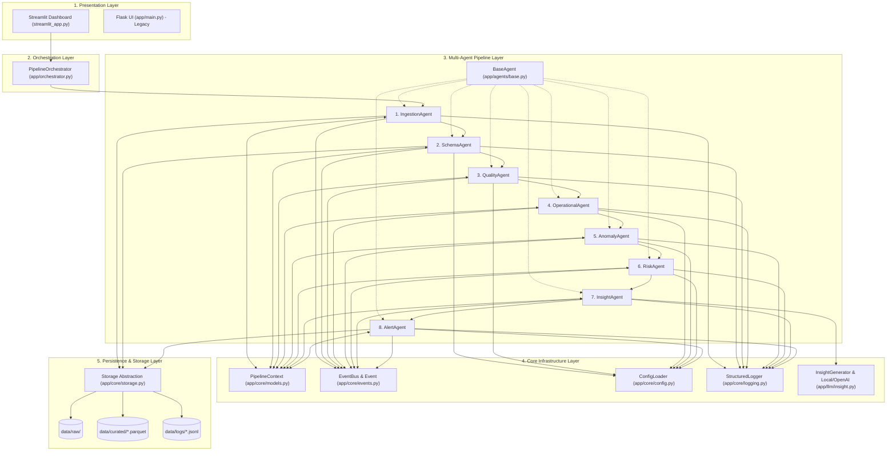
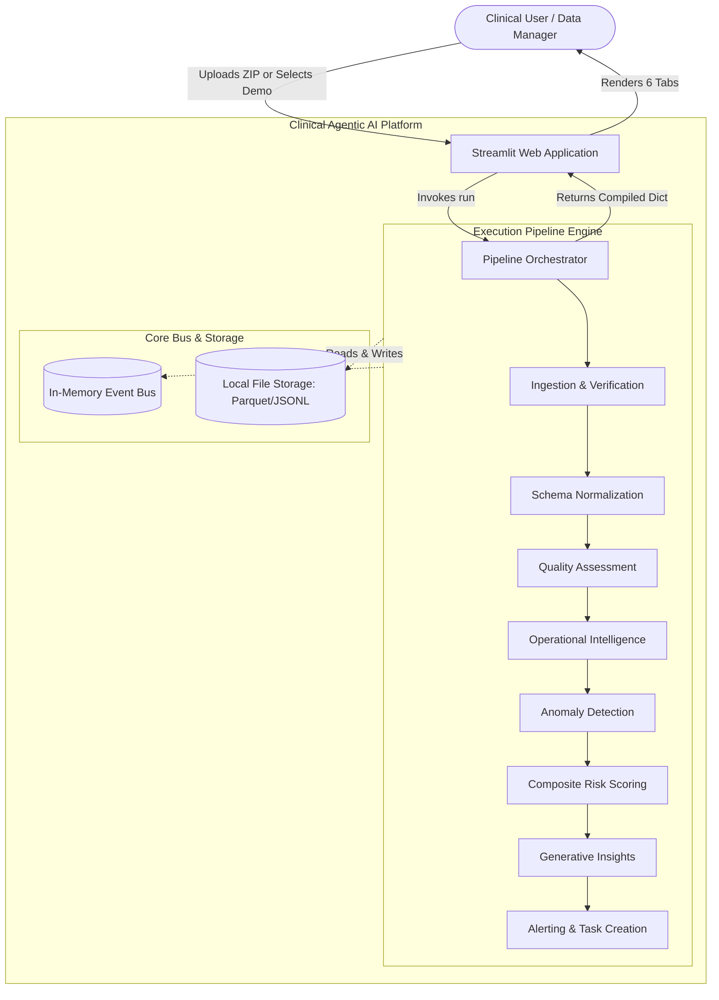
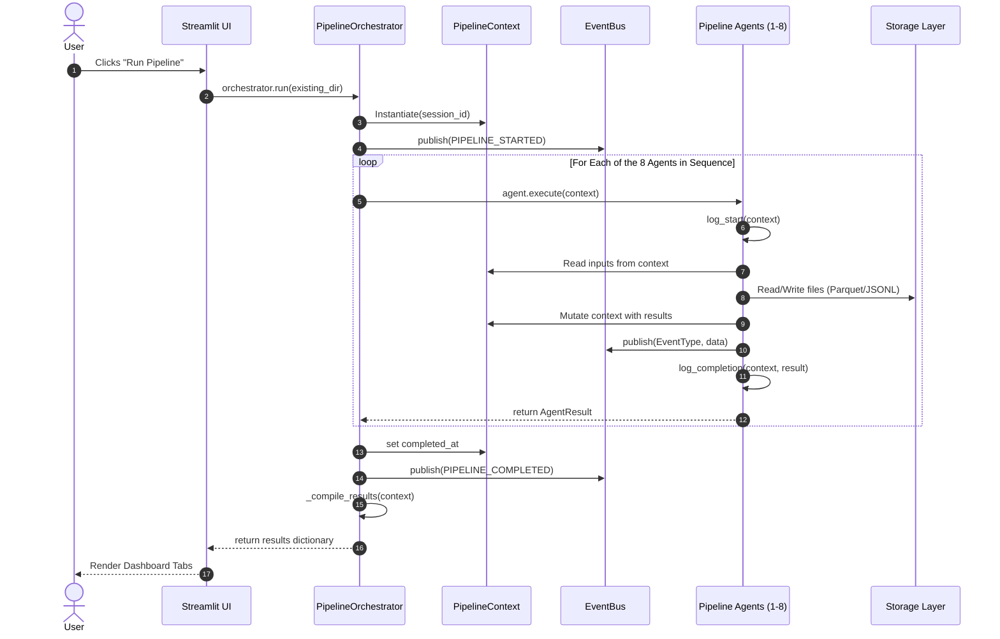
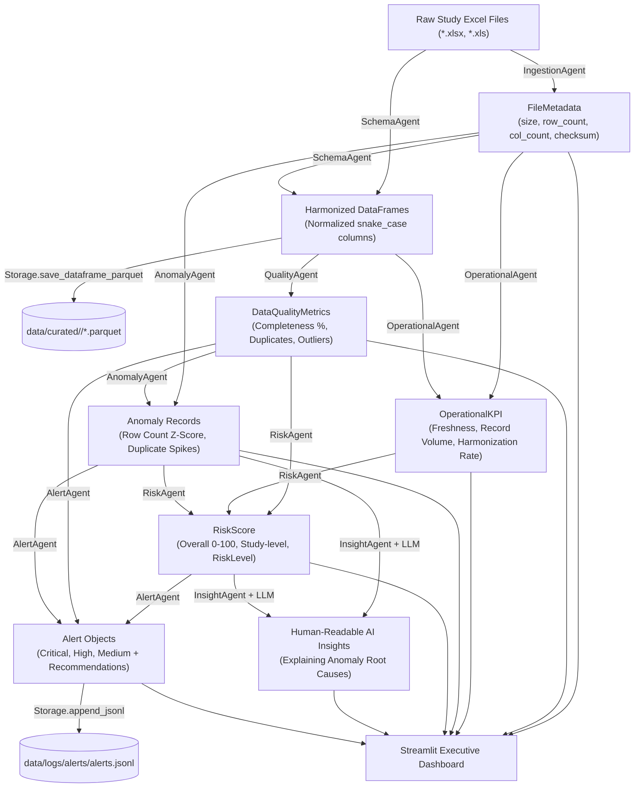
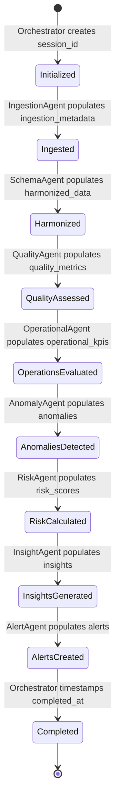

# Phase 3A & 3B: Complete System Architecture & Mermaid Diagrams

---

## 1. Architectural Style & Paradigm

The platform is designed as an **Event-Driven Modular Monolith with an Agentic Pipeline Pattern**. 

```
┌────────────────────────────────────────────────────────────────────────┐
│                        ARCHITECTURAL PARADIGM                          │
├──────────────────────────┬─────────────────────────────────────────────┤
│ Modular Monolith         │ Code organized into cleanly decoupled       │
│                          │ packages (app/core, app/agents, app/llm)    │
│                          │ sharing a single execution process.         │
├──────────────────────────┼─────────────────────────────────────────────┤
│ Multi-Agent Pipeline     │ 8 discrete, autonomous functional agents    │
│                          │ inheriting from BaseAgent, each responsible │
│                          │ for a single bounded domain task.           │
├──────────────────────────┼─────────────────────────────────────────────┤
│ Event-Driven Messaging   │ State changes emit structured Event objects │
│                          │ onto an EventBus for loose coupling and     │
│                          │ auditability.                               │
├──────────────────────────┼─────────────────────────────────────────────┤
│ Blackboard State Pattern │ All agents read from and mutate a shared    │
│                          │ PipelineContext object across lifecycle.    │
└──────────────────────────┴─────────────────────────────────────────────┘
```

### Why This Architecture Was Chosen
1. **Separation of Concerns**: Clinical trial intelligence encompasses diverse operations (parsing binary Excel sheets, string token mapping, statistical math, narrative prompt formatting, and disk I/O). Isolating each into an independent Agent prevents "spaghetti code."
2. **Zero Deployment Friction**: Unlike distributed microservices requiring Docker Compose, Kubernetes, and network service discovery, this architecture runs in any Python 3.10+ environment while maintaining strict internal boundaries.
3. **Deterministic Auditability**: Regulated life-sciences software requires 100% reproducible execution paths. Linear orchestration coupled with event-bus publishing provides a clear, verifiable audit trail.

---

## 2. Layered Architecture Breakdown



### Layer Responsibilities & Boundaries

1. **Presentation Layer (`streamlit_app.py`)**:
   - Manages UI controls, file upload widgets, threshold sliders, and tab navigation.
   - Converts raw Python dictionaries and lists from `PipelineContext` into Plotly visualizations and data tables.
   - Never directly touches file disks or performs math calculations; delegates everything to `PipelineOrchestrator`.

2. **Orchestration Layer (`app/orchestrator.py`)**:
   - Initializes core infrastructure (`ConfigLoader`, `Storage`, `EventBus`, `StructuredLogger`).
   - Instantiates all 8 agents and wires their dependencies.
   - Manages execution lifecycle, handles directory copying/unzipping, traps unhandled exceptions, and compiles the final executive summary.

3. **Agent Layer (`app/agents/`)**:
   - Each agent inherits from `BaseAgent`.
   - Each agent receives the mutable `PipelineContext`, executes its specialized logic, publishes lifecycle events to the `EventBus`, and returns an `AgentResult` object.

4. **Core Infrastructure Layer (`app/core/`)**:
   - `models.py`: Strongly-typed Python dataclasses and enums providing type safety across the entire application.
   - `config.py`: Encapsulates configuration parsing with recursive dictionary updates and dot-notation lookups.
   - `events.py`: Implements synchronous in-memory Publish-Subscribe messaging.
   - `logging.py`: Dual console and append-only JSON Lines structured logger.
   - `llm/insight.py`: Strategy pattern abstracting template generation from OpenAI API calls.

5. **Storage Layer (`app/core/storage.py`)**:
   - Provides a clean abstracted interface for saving and loading Parquet, CSV, JSON, and JSONL data without exposing direct `os` or `pathlib` manipulations to high-level agents.

---

## 3. Comprehensive Mermaid Diagrams

### Diagram 1: High-Level System Architecture



#### Diagram 1 Explanation:
- **User Node**: Represents the clinical investigator, CRA, or data manager interacting via a browser.
- **UI Node**: Streamlit application capturing user input and displaying interactive results.
- **Pipeline Orchestrator**: The central controller coordinating execution.
- **PipelineEngine Stages (1 to 8)**: The linear execution pipeline where each stage builds on the results of previous stages.
- **EventBus**: Captures every state change as an immutable event for auditability.
- **FileStorage**: Local directory structure storing raw files, curated Parquet tables, and JSONL alert logs.

---

### Diagram 2: Multi-Agent Interaction & Event-Bus Topology



#### Diagram 2 Explanation:
- **Steps 1-4**: The user triggers execution; the orchestrator assigns a unique UUID `session_id`, creates the empty blackboard `PipelineContext`, and fires the `PIPELINE_STARTED` event.
- **Steps 5-13 (The Agent Loop)**: Each agent sequentially receives the shared `context`. It logs its invocation, reads prior results, performs its transformations, writes artifacts through `Storage`, updates the `context` in place, fires an event on `EventBus`, and returns an `AgentResult` containing execution metadata.
- **Steps 14-18**: The orchestrator marks completion, compiles the final payload, and Streamlit re-renders the UI reactively.

---

### Diagram 3: Complete Data Flow & Artifact Transformation



#### Diagram 3 Explanation:
- Demonstrates how raw, untrusted data flows progressively through the pipeline.
- Raw Excel workbooks are transformed into structured in-memory `DataFrame` objects.
- Normalized tables are permanently persisted into compressed columnar Parquet files (`data/curated/`).
- Statistical metrics (`DataQualityMetrics`, `OperationalKPI`, `Anomaly`) feed into the composite `RiskScore`.
- Finally, explanatory insights and actionable alerts are emitted to `alerts.jsonl` and rendered on screen.

---

### Diagram 4: PipelineContext State Lifecycle (Blackboard Pattern)



#### Diagram 4 Explanation:
- Visualizes the `PipelineContext` as it moves across state transitions.
- Each agent acts as a pure state transform function: $f(\text{Context}) \to \text{Context}'$.
- At no point is state stored in global variables or static singletons, guaranteeing isolation between concurrent sessions.
