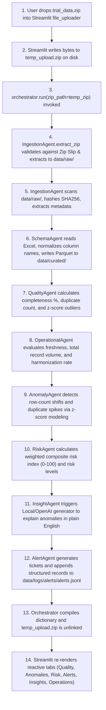

# Phase 6: End-to-End Execution Flow Traces

---

## Scenario 1: Streamlit User Uploads ZIP File via Web UI



### Detailed Step-by-Step Code Walkthrough

1. **User Action**: The clinical data manager opens the web dashboard in their browser, selects "Upload ZIP", and uploads `Study_Package.zip`.
2. **File Buffering (`streamlit_app.py:131-136`)**:
   - Streamlit captures the `UploadedFile` buffer.
   - The buffer is written to a temporary local disk file: `temp_zip = Path("temp_upload.zip"); temp_zip.write_bytes(zip_bytes)`.
   - `results = orchestrator.run(zip_path=temp_zip)` is called inside a `st.spinner()` block.
3. **Session Initialization (`app/orchestrator.py:110-124`)**:
   - Generates a unique UUIDv4 string: `session_id = str(uuid.uuid4())`.
   - Creates the blackboard context: `context = PipelineContext(session_id=session_id)`.
   - Emits `EventType.PIPELINE_STARTED` event to `EventBus`.
   - Logs: `[INFO] Starting pipeline execution | {"session_id": "..."}`.
4. **Safe Extraction (`app/agents/ingestion_agent.py:143-156`)**:
   - Calls static method `IngestionAgent.extract_zip(zip_path, self.storage.raw_path)`.
   - For every entry in the archive, resolves `(extract_to / member).resolve()`.
   - **Security Gate**: If the resolved path does not start with `extract_to.resolve()`, raises `ValueError("Path traversal attempt detected")`.
   - Safely extracts files to `data/raw/`.
5. **Ingestion & Provenance Tracking (`app/agents/ingestion_agent.py:47-116`)**:
   - `IngestionAgent.execute(context)` scans `data/raw/**/*.xlsx`.
   - Computes SHA256 checksum in 4KB chunks via `hashlib.sha256()`.
   - Extracts `study_id` using regex `\b(Study\s*\d+)\b`.
   - Reads workbook dimensions via `openpyxl` (`ws.max_row - 1`, `ws.max_column`).
   - Appends `FileMetadata` instances to `context.ingestion_metadata`.
   - Emits `EventType.FILE_INGESTED` with file count payload.
6. **Schema Normalization (`app/agents/schema_agent.py:26-81`)**:
   - `SchemaAgent.execute(context)` iterates through `context.ingestion_metadata`.
   - Loads each file via `pd.read_excel(metadata.file_path)`.
   - Normalizes column headers using `self.alias_map` lookup (`Subject ID` $\to$ `subject_id`).
   - Serializes clean table to Parquet: `self.storage.save_dataframe_parquet(harmonized_df, dataset_name, study=metadata.study_id)`.
   - Populates `context.harmonized_data[dataset_name] = harmonized_df`.
   - Emits `EventType.SCHEMA_HARMONIZED`.
7. **Quality Assessment (`app/agents/quality_agent.py:27-81`)**:
   - `QualityAgent.execute(context)` evaluates each DataFrame in `context.harmonized_data`.
   - Vectorized completeness: non-null cells / total cells.
   - Vectorized duplicate detection: `df.duplicated().sum()`.
   - Vectorized numeric outlier detection: z-score $|z| > 3.0$.
   - Computes overall quality score: $(0.50 \times C) + (0.30 \times V) + (0.20 \times K)$.
   - Populates `context.quality_metrics[name] = DataQualityMetrics(...)`.
   - Emits `EventType.QUALITY_ASSESSED`.
8. **Operational Intelligence (`app/agents/operational_agent.py:23-118`)**:
   - `OperationalAgent.execute(context)` evaluates trial health:
     - Volume: Total records aggregated across files.
     - Freshness: File modification timestamp age vs. threshold (14/28 days).
     - Throughput: Harmonization ratio (harmonized / total files).
     - Study activity: Record counts grouped by study.
   - Appends `OperationalKPI` instances to `context.operational_kpis`.
   - Emits `EventType.OPERATIONS_EVALUATED`.
9. **Statistical Anomaly Detection (`app/agents/anomaly_agent.py:23-95`)**:
   - `AnomalyAgent.execute(context)`:
     - Detects row-count volume anomalies using sample-bounded z-scores: $|z| \ge 2.5$, or $|z| \ge 1.3$ for small cohorts ($N < 10$).
     - Flags low-completeness ($< 60\%$) and duplicate surges ($> 50$ rows).
   - Appends `Anomaly` instances to `context.anomalies`.
   - Emits `EventType.ANOMALY_DETECTED`.
10. **Multi-Factor Risk Scoring (`app/agents/risk_agent.py:29-59`)**:
    - `RiskAgent.execute(context)`:
      - Computes composite trial-wide risk: $(100 - \bar{Q}) \times 0.50 + S_{\text{ops}} \times 0.25 + S_{\text{anom}} \times 0.25$.
      - Computes per-study risk for each distinct study token.
      - Maps numeric scores to `RiskLevel` (`LOW`, `MODERATE`, `HIGH`, `CRITICAL`).
      - Populates `context.risk_scores`.
      - Emits `EventType.RISK_CALCULATED`.
11. **Natural Language Insight Generation (`app/agents/insight_agent.py:24-49`)**:
    - `InsightAgent.execute(context)`:
      - Iterates through flagged `Anomalies` and high-risk scores ($> 60$).
      - Calls `InsightGenerator.generate_insight()` (either `LocalInsightGenerator` templating or `OpenAIInsightGenerator`).
      - Appends narrative explanations to `context.insights`.
      - Emits `EventType.INSIGHT_GENERATED`.
12. **Alert Dispatch & Log Persistence (`app/agents/alert_agent.py:25-70`)**:
    - `AlertAgent.execute(context)`:
      - Evaluates risk scores $\ge 60$ (Critical $\ge 75$, High $\ge 60$).
      - Evaluates quality scores $< 70\%$ (High $< 50\%$, Medium $< 70\%$).
      - Evaluates critical anomalies.
      - Creates `Alert` objects with evidence and recommended actions.
      - Appends alert dictionaries to disk: `self.storage.append_jsonl(alert_dicts, "alerts", subdir="alerts")`.
      - Appends `Alert` instances to `context.alerts`.
      - Emits `EventType.ALERT_CREATED`.
13. **Final Compilation & Cleanup (`app/orchestrator.py:146-172`)**:
    - Records completion timestamp `context.completed_at`.
    - Dispatches `EventType.PIPELINE_COMPLETED`.
    - Calls `_compile_results(context)` to build dictionary output.
    - `temp_zip.unlink()` deletes the temporary uploaded archive from disk.
14. **Dashboard Render (`streamlit_app.py:143-400`)**:
    - Stores payload in `st.session_state.pipeline_results`.
    - Reruns UI script, rendering executive summary KPI cards and all 6 tabs.

---

## Scenario 2: Streamlit User Runs Pipeline on Local Demo Data

1. User selects "Demo Dataset" from sidebar radio button.
2. `demo_path` auto-detects `data/demo` (which contains 83 study files organized into subfolders `Study 1`, `Study 2`, ..., `General`).
3. User clicks **"Run Pipeline"**.
4. Orchestrator executes `_copy_existing_dir(existing_dir)`:
   - Recursively glob-matches `**/*.xlsx` and `**/*.xls`.
   - Replicates relative directory structure into `data/raw/` using `shutil.copy2`.
5. Steps 5 through 14 from Scenario 1 execute identically, reading raw files from `data/raw/`.

---

## Scenario 3: Headless CLI / Automated Test Suite Execution

```python
from pathlib import Path
from app.orchestrator import PipelineOrchestrator

orchestrator = PipelineOrchestrator(
    config_path=Path("config/config.yaml"),
    data_base_path=Path("data"),
)
results = orchestrator.run(existing_dir=Path("data/demo/Study 1"))
assert results["success"] is True
print(f"Ingested {results['summary']['files_ingested']} files in session {results['session_id']}")
```
- Operates entirely headless without starting a web server or graphical UI.
- All events are captured in `data/logs/orchestrator.jsonl` and `data/logs/alerts/alerts.jsonl`.
- Return code `0` on success; exits gracefully with error details if an unhandled failure occurs.
