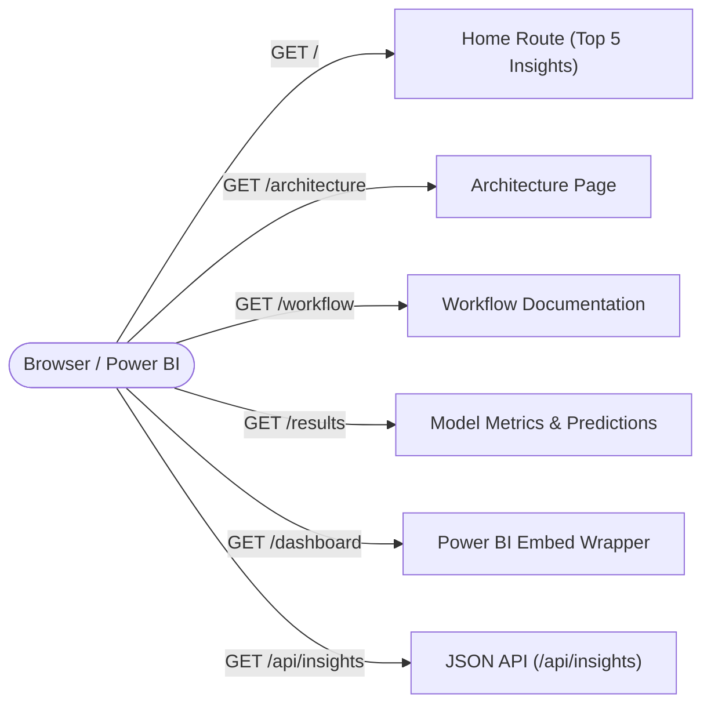

# Phase 7: Data Architecture, Storage Layout & API Analysis

---

## 1. Clinical Trial Data Sources & Spreadsheet Anatomy

The platform ingests heterogeneous spreadsheets from Electronic Data Capture (EDC) systems and Clinical Data Management Systems (CDMS). Below is a breakdown of the 8 real-world file types processed by the pipeline:

| Dataset / File Type | Clinical Purpose & Domain Context | Key Columns (Raw $\to$ Canonical) | Downstream Pipeline Usage |
| :--- | :--- | :--- | :--- |
| **CPID EDC Metrics** | Subject enrollment, site mapping, and trial milestone tracking. | `Subject ID` $\to$ `subject_id`<br/>`Site` $\to$ `site_id`<br/>`Country` $\to$ `country`<br/>`Latest Visit` $\to$ `visit_name` | Primary backbone mapping subjects to trial sites and countries. |
| **Compiled EDRR** | Electronic Data Record Review: tracks open query backlogs and data issue counts. | `Subject` $\to$ `subject_id`<br/>`Total Open Issue Count Per Subject` $\to$ `open_issue_count` | Evaluated for query accumulation and site response sluggishness. |
| **eSAE Dashboard** | Serious Adverse Event reporting for safety oversight (deaths, hospitalizations). | `Subject ID` $\to$ `subject_id`<br/>`Adverse Event` $\to$ `adverse_event`<br/>`SAE` $\to$ `serious_adverse_event` | Critical safety risk trigger; feeds into medical alerts. |
| **Global Coding (MedDRA)** | Adverse event verbatim medical terms mapped to standardized MedDRA dictionary hierarchy. | `Verbatim Term` $\to$ `adverse_event`<br/>`PT (Preferred Term)` $\to$ `preferred_term`<br/>`SOC (System Organ Class)` | Monitored for unmapped/uncoded terms and toxicity patterns. |
| **Global Coding (WHODD)** | Concomitant medications mapped to WHO Drug Dictionary. | `Drug Name` $\to$ `medication_name`<br/>`ATC Code` $\to$ `atc_code` | Identifies prohibited concomitant medications. |
| **Inactivated Forms & Records** | Audit log of clinical forms removed or inactivated by site coordinators. | `Folder` $\to$ `folder_name`<br/>`Form` $\to$ `form_name`<br/>`Record Status` $\to$ `record_status` | High volumes indicate site confusion or protocol amendment churn. |
| **Missing Lab Names & Ranges** | Clinical lab results submitted without reference ranges (units, normal limits). | `Subject ID` $\to$ `subject_id`<br/>`Lab Test` $\to$ `lab_test`<br/>`Range Status` | Evaluated by QualityAgent; missing ranges invalidate lab data. |
| **Visit Projection Tracker** | Forecasted vs. actual patient visit schedule compliance. | `Subject` $\to$ `subject_id`<br/>`Visit Date` $\to$ `visit_date`<br/>`Projected Date` | Feeds OperationalAgent to detect missed or overdue visits. |

---

## 2. Declarative Schema Normalization Engine

In `app/agents/schema_agent.py`, the schema agent utilizes the alias map defined in `config/config.yaml`:

```
┌────────────────────────────────────────────────────────┐
│                   ALIAS MAPPING ENGINE                 │
├─────────────────────────┬──────────────────────────────┤
│ RAW SPREADSHEET HEADER  │ CANONICAL NORMALIZED NAME    │
├─────────────────────────┼──────────────────────────────┤
│ "Subject ID"            │ subject_id                   │
│ "SubjectID"             │ subject_id                   │
│ "Subj_ID"               │ subject_id                   │
│ "Site"                  │ site_id                      │
│ "Site ID"               │ site_id                      │
│ "SiteName"              │ site_id                      │
│ "Visit"                 │ visit_name                   │
│ "Visit Name"            │ visit_name                   │
│ "Visit Date"            │ visit_date                   │
│ "Date"                  │ visit_date                   │
│ "DateTime"              │ visit_date                   │
│ "Adverse Event"         │ adverse_event                │
│ "SAE"                   │ serious_adverse_event        │
│ "Status"                │ record_status                │
│ "Metric"                │ metric_name                  │
│ "Value"                 │ metric_value                 │
└─────────────────────────┴──────────────────────────────┘
```

---

## 3. Storage Hierarchy & Partitioning

The `Storage` layer (`app/core/storage.py`) enforces a clean, deterministic physical directory structure:

```
data/
│
├── raw/                              <-- Untouched ingested spreadsheets
│   ├── Study 1/
│   │   ├── Study 1_Compiled_EDRR_updated.xlsx
│   │   └── Study 1_CPID_EDC_Metrics_URSV2.0.xlsx
│   └── Study 2/
│       └── ...
│
├── staging/                          <-- Temporary extraction buffers (Zip extracts)
│
├── curated/                          <-- Partitioned Apache Parquet columnar tables
│   ├── Study 1/
│   │   ├── Study 1_Compiled_EDRR_updated.parquet
│   │   └── Study 1_CPID_EDC_Metrics_URSV2.0.parquet
│   └── Study 2/
│       └── ...
│
└── logs/                             <-- Audit trails and alert logs
    ├── alerts/
    │   └── alerts.jsonl              <-- Append-only ticket log
    └── orchestrator.jsonl            <-- Execution lifecycle trace
```

### Why Partition by Study?
In `Storage.save_dataframe_parquet(df, name, study)`:
- Parquet files are partitioned into subdirectories named after the `study_id` (e.g., `data/curated/Study 1/`).
- **Performance Benefit**: Central monitors analyzing `Study 1` do not need to scan through files belonging to `Study 2` through `Study 13`. This enables **partition pruning** during file scans.

---

## 4. REST API Analysis (Legacy Flask Subsystem in `app/main.py`)

The repository also includes an exploratory Flask REST API (`app/main.py`) designed to interface with frontend dashboards or Power BI embeds:



### Detailed Endpoint Specifications

#### 1. `GET /`
- **Purpose**: Landing page rendering hero metrics and top 5 high-risk site insights.
- **Template**: `app/templates/home.html`.
- **Query Logic**: Filters `insights_df.sort_values("risk_probability", ascending=False).head(5)`.

#### 2. `GET /architecture`
- **Purpose**: Displays system architecture documentation and pipeline topology.
- **Template**: `app/templates/architecture.html`.

#### 3. `GET /workflow`
- **Purpose**: Step-by-step walkthrough of clinical data harmonization and risk scoring.
- **Template**: `app/templates/workflow.html`.

#### 4. `GET /results`
- **Purpose**: Surfaces machine learning model metrics (ROC-AUC, Precision, Recall, Confusion Matrix) and sample predictions.
- **Template**: `app/templates/results.html`.
- **Data Source**: `outputs/model_metrics.json` and `outputs/site_risk_predictions.csv`.

#### 5. `GET /dashboard`
- **Purpose**: Embedded analytics dashboard displaying a Power BI report iframe and prioritized insights list.
- **Template**: `app/templates/dashboard.html`.

#### 6. `GET /api/insights`
- **Purpose**: Headless JSON endpoint for external services to fetch the top 20 prioritized site risks.
- **HTTP Method**: `GET`.
- **Response Format**: `application/json`.
- **Sample JSON Payload**:
  ```json
  [
    {
      "site_id": "Site-101",
      "country": "Germany",
      "risk_probability": 0.87,
      "ai_insight": "High SAE occurrence coupled with query backlog exceeding 45 days.",
      "alerts": "CRITICAL_SAFETY_BACKLOG"
    }
  ]
  ```
- **Status Codes**:
  - `200 OK`: Successful retrieval.
  - `500 Internal Server Error`: Unhandled server exception.

---

## 5. JSON Lines (`alerts.jsonl`) Schema

Alerts emitted by `AlertAgent` are appended to `data/logs/alerts/alerts.jsonl`:

```json
{
  "alert_id": "6aaec008-be1c-4178-99d0-654f645b3859",
  "severity": "high",
  "title": "High Risk: Study 1",
  "description": "Risk score: 68.5. Quality: 12.5, Operational: 25.0, Anomaly: 30.0",
  "study_id": "Study 1",
  "site_id": null,
  "status": "open",
  "created_at": "2026-11-24T08:11:48.012345+00:00"
}
```
- **Why JSONL?**: Unlike standard JSON which requires parsing an entire array `[...]` into memory to add a new item, JSON Lines allows appending a single line with an $O(1)$ write operation (`file.write(json.dumps(...) + "\n")`).
