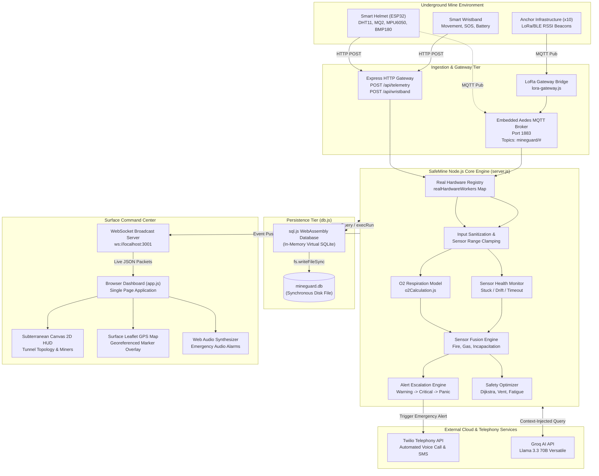
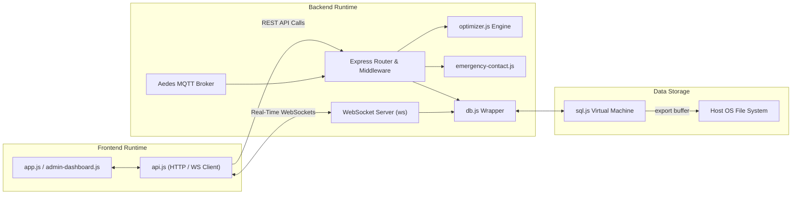
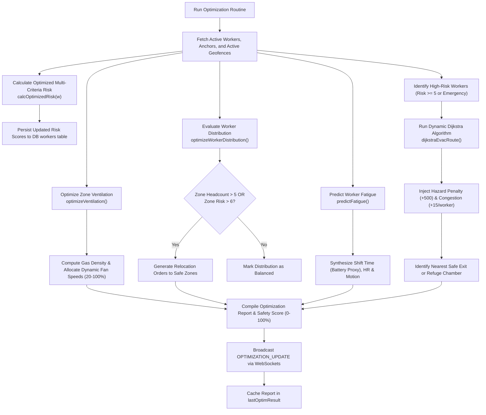
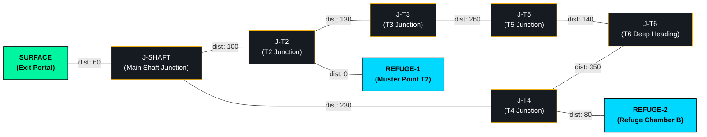
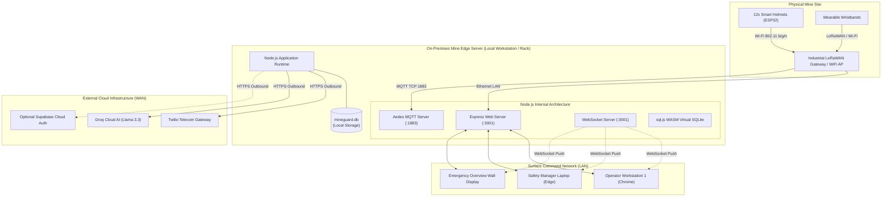

# SafeMine: Architecture & System Design

---

## 1. Architectural Pattern & Paradigm

SafeMine is structured as an **Event-Driven, Layered Cyber-Physical Monolith with Reactive Push Streaming**.

```
+----------------------------------------------------------------------------------------------------+
|                                    FIVE-TIER ARCHITECTURAL STACK                                   |
+----------------------------------------------------------------------------------------------------+
| Tier 1: Hardware & Sensing Layer        ESP32 C++ Firmware, FreeRTOS, I2C/ADC Bus, Wearable Sensor |
| Tier 2: Ingestion & Gateway Layer       Express HTTP Endpoint, Embedded Aedes MQTT Broker          |
| Tier 3: Business Logic & Optimizer      Sensor Fusion, Oxygen Depletion Model, Dijkstra Pathfinding|
| Tier 4: Persistence & Storage Layer     sql.js WebAssembly SQLite Engine, Sync Disk Exporter       |
| Tier 5: Presentation & Client Layer     HTML5 Canvas 2D Engine, Leaflet GPS, WebSockets Client     |
+----------------------------------------------------------------------------------------------------+
```

### Architectural Classification
1. **Event-Driven**: Sensor readings, MQTT topic publications, and threshold infractions emit events that trigger asynchronous callbacks, state updates, and real-time WebSocket broadcasts.
2. **Modular Monolith**: All server-side components (MQTT broker, REST API server, WebSocket hub, database interface, and analytical optimization engine) execute concurrently within a single Node.js runtime process.
3. **Pipeline-Based Data Processing**: Telemetry undergoes a strict linear pipeline:
   $$\text{Ingestion} \longrightarrow \text{Normalization} \longrightarrow \text{Validation/Clamping} \longrightarrow \text{State Mutation} \longrightarrow \text{Sensor Fusion} \longrightarrow \text{Escalation / Downlink} \longrightarrow \text{Client Broadcast}$$
4. **Client-Server with Full-Duplex Push**: While setup and administrative configurations use standard REST request-response cycles, real-time telemetry uses continuous WebSocket push streaming, eliminating client polling.

---

## 2. Layer-by-Layer Architectural Breakdown

### Tier 1: Hardware & Sensing Layer (`ESP32.ino`)
- **Responsibilities**:
  - Interfacing with physical hardware pins: GPIO 34 (MQ-2 analog ADC), GPIO 4 (DHT11 1-wire), I2C pins GPIO 21/22 (Wire bus for MPU-6050 and BMP085/180), and GPIO 25 (piezoelectric buzzer).
  - Executing local edge processing: computing 3D motion differential ($\Delta = |\Delta x| + |\Delta y| + |\Delta z|$), calculating shock magnitude ($\sqrt{x^2+y^2+z^2} > 3.0\text{g}$), and evaluating fall impact windows ($5000\text{ms}$).
  - Executing local oxygen depletion calculations mirroring the backend algorithm.
  - Packaging readings into a JSON payload and dispatching HTTP POST requests every $3000\text{ms}$.

### Tier 2: Ingestion & Gateway Layer (`server.js`, `lora-gateway.js`)
- **Responsibilities**:
  - Providing multi-protocol ingestion:
    - **HTTP REST**: `POST /api/telemetry` for Wi-Fi-enabled nodes and `POST /api/wristband` for wearable distress bands.
    - **MQTT Broker**: Embedded Aedes server listening on port 1883, handling subscriptions for topics `mineguard/helmet/#`, `mineguard/wristband/#`, and `mineguard/anchor/#`.
  - Rate limiting incoming HTTP requests via `express-rate-limit` ($300\text{ req/minute}$).
  - Managing downlink feedback: Publishing commands back to physical nodes on `mineguard/helmet/:id/downlink`.

### Tier 3: Business Logic & Processing Pipeline
- **Responsibilities**:
  - **Dynamic Sensor Validation & Clamping**: Mitigating sensor glitches by rejecting impossible values (e.g., $\text{CH}_4 > 5\%$, $\text{Temp} > 80^\circ\text{C}$).
  - **Hardware Exemption Registry**: Maintaining the `realHardwareWorkers` Map to ensure real hardware data is not overwritten by internal simulation routines.
  - **Sensor Health Monitor**: Detecting flatlined/stuck sensors ($0$ or max streaks) and telemetry dropouts ($10\text{s}$ warning, $30\text{s}$ critical).
  - **Sensor Fusion Engine**: Evaluating cross-sensor patterns (Gas Accumulation, Fire Signatures, Incapacitated Miners).
  - **Multi-Stage Escalation Engine**: Managing timers for automatic state transitions from Warning ($10\text{s}$) to Critical ($20\text{s}$) to Panic.
  - **Optimization Suite (`optimizer.js`)**: Executing Dijkstra shortest-path evacuation routing, proportional ventilation fan control, worker redistribution, and predictive fatigue modeling.

### Tier 4: Persistence & Storage Layer (`db.js`, `mineguard.db`)
- **Responsibilities**:
  - Providing a synchronous, SQLite-compatible interface wrapped around WebAssembly `sql.js`.
  - Maintaining relational schemas: `workers`, `telemetry`, `alerts`, `devices`, `sensor_faults`, `anchors`, `incidents`, `evacuations`, `geofences`, `refuges`, `drones`, and `settings`.
  - Exporting the in-memory SQLite binary array to `mineguard.db` on disk upon every mutating SQL operation.

### Tier 5: Presentation & Client Layer (`index.html`, `app.js`, `admin-dashboard.js`)
- **Responsibilities**:
  - Maintaining active full-duplex WebSocket communication with automatic reconnection.
  - Rendering subterranean spatial positions on an HTML5 Canvas 2D engine with animated miner vectors, anchor signal circles, depth gradients, and pulsing hazard zones.
  - Rendering surface GPS telemetry using Leaflet.js map tiles.
  - Visualizing real-time telemetry time-series using Chart.js.
  - Generating synthesized audio tones using the Web Audio API for emergency notifications.
  - Interfacing with the Groq AI Copilot via `/api/chat`.

---

## 3. High-Level System Architecture Diagram



### Node & Arrow Explanation
1. **`H1` $\to$ `HTTP_IN` & `MQTT_IN`**: The physical ESP32 helmet pushes JSON telemetry over either direct Wi-Fi HTTP or MQTT.
2. **`W1` $\to$ `HTTP_IN`**: The fallback wristband submits vital signs and emergency SOS state to `/api/wristband`.
3. **`HW_REG` (Real Hardware Registry)**: Stamps the hardware ID in a volatile memory map to exempt it from simulator overwrites.
4. **`CLAMP` (Input Sanitization)**: Validates incoming readings against physiological and physical limits, preventing sensor glitches from triggering false safety alarms.
5. **`O2_MOD` (Oxygen Calculation Engine)**: Calculates dynamic ambient oxygen based on worker count and gas displacement.
6. **`FUSION` $\to$ `ESCAL`**: When combined hazard criteria are met, the escalation state machine initiates a staged alert timer.
7. **`ESCAL` $\to$ `TWILIO`**: High-severity emergencies trigger automated SMS and voice phone calls with synthesized TwiML voice alerts.
8. **`WASM_DB` $\to$ `DISK_FILE`**: Mutating SQL operations trigger synchronous byte serialization from WebAssembly memory to `mineguard.db`.
9. **`WS_HUB` $\to$ `SPA`**: All processed telemetry, alerts, and device status updates are pushed immediately to all connected browsers.

---

## 4. Component Interaction Diagram



---

## 5. End-to-End Data Flow Pipeline

```mermaid
sequenceDiagram
    autonumber
    participant HW as ESP32 Helmet
    participant SRV as SafeMine Server (server.js)
    participant O2 as O2 Physics Engine (o2Calculation.js)
    participant DB as SQLite (sql.js / WASM)
    participant OPT as Optimizer (optimizer.js)
    participant WS as WebSocket Clients (Browsers)
    participant TW as Twilio Voice/SMS API

    HW->>SRV: HTTP POST /api/telemetry (CH4, CO, Temp, Accelerometer)
    Note over SRV: 1. Record Hardware ID in realHardwareWorkers<br/>2. Validate & Clamp Readings
    SRV->>O2: calculateOxygenLevel(workerCount, ch4)
    O2-->>SRV: Dynamic O2 % (e.g. 19.2% - WARNING)
    SRV->>SRV: calcRisk(telemetry) -> Computes Risk Score (0-10)
    SRV->>DB: Upsert into workers & Insert into telemetry table
    Note over DB: Synchronously export WASM memory & write mineguard.db

    alt Hazard Detected (e.g., CH4 > 1.0% or Panic Pressed)
        SRV->>SRV: checkSafetyThresholds() & checkSensorFusion()
        SRV->>DB: INSERT INTO alerts (Critical / Emergency)
        SRV->>WS: Broadcast NEW_ALERT & WORKER_UPDATE
        SRV->>OPT: dijkstraEvacRoute(workerX, workerY)
        OPT-->>SRV: Optimal Evacuation Path avoiding hazards
        SRV->>WS: Broadcast ESCALATION_STAGE & Evacuation Route
        SRV->>TW: notifyAdmin() -> Outbound Voice Call (TwiML) & SMS
        SRV->>HW: Downlink MQTT: EVACUATE IMMEDIATELY (Beep buzzer)
    else Normal Operating Conditions
        SRV->>WS: Broadcast WORKER_UPDATE
    end
```

---

## 6. Evacuation Routing & Optimization Workflow

The optimization subsystem (`optimizer.js`) executes every $30\text{ seconds}$ or on demand:



---

## 7. Subterranean Evacuation Topology (Graph Representation)

The evacuation routing engine models the underground mine as an undirected, weighted graph:



---

## 8. Deployment Architecture



### Deployment Rationale
Underground safety systems **must prioritize local survivability**. If an underground explosion or storm severs the surface facility’s external Internet connection:
- The local on-premises edge server continues to broker MQTT packets, execute sensor fusion, calculate Dijkstra evacuation routes, sound browser HUD sirens, and actuate physical helmet buzzers.
- Only external cloud enrichments (Groq AI Chatbot and Twilio outbound PSTN calling) degrade gracefully.
