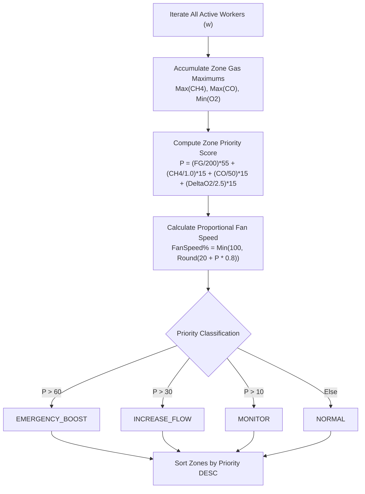

# SafeMine: Algorithmic Complexity & Mathematical Models

---

## 1. Algorithmic Overview

SafeMine uses specialized computational geometry, graph theory, numerical physics, and multi-criteria heuristic scoring algorithms to transform raw sensor telemetry into actionable life-safety decisions.

```
+---------------------------------------------------------------------------------------------------+
|                                 SAFEMINE ALGORITHMIC INVENTORY                                    |
+------------------------------------+--------------------------+------------------+----------------+
| Algorithmic Subsystem              | Primary Mathematical Basis| Time Complexity  | Space Complexity|
+------------------------------------+--------------------------+------------------+----------------+
| Dynamic Evacuation Pathfinding     | Dijkstra Shortest Path   | O(V^2 + E)       | O(V + E)       |
| Multi-Criteria Risk Scoring        | Non-linear logarithmic   | O(1)             | O(1)           |
| Oxygen Depletion & Displacement    | Respiration & Dalton Law | O(1)             | O(1)           |
| Proportional Ventilation Optimizer | Greedy Priority Queue    | O(W + Z log Z)   | O(Z)           |
| Worker Capacity Redistribution     | Greedy Constraint Balance| O(W + Z log Z)   | O(Z)           |
| Predictive Fatigue Estimation      | Multi-Factor Biometric   | O(W log W)       | O(W)           |
| Fall & Impact Classification       | 3D Vector Kinematics     | O(1)             | O(1)           |
| Spatial Geofence Collision Check   | Euclidean Point-to-Circle| O(W * G)         | O(1)           |
+------------------------------------+--------------------------+------------------+----------------+
```

---

## 2. Dynamic Hazard-Penalized Dijkstra Shortest Path

### Intuition & Problem Solved
Underground mine tunnels form an interconnected labyrinth. When an emergency occurs (such as a methane explosion or toxic carbon monoxide pocket in Zone C), workers must reach the nearest surface portal or life-support refuge chamber. 
A naive shortest-path algorithm (like standard Dijkstra using physical distance) would direct miners along the physically shortest tunnel, straight through the toxic gas pocket. SafeMine's algorithm dynamically increases the mathematical weight of contaminated passages so the pathfinding engine naturally routes workers around hazards.

---

### Step-by-Step Algorithm
1. **Model Mine Topology**: Represent the mine as an undirected graph $G = (V, E)$, where $V$ represents tunnel junctions, exits, and refuge chambers, and $E$ represents physical tunnel segments with base Euclidean length $L(e)$.
2. **Anchor Ingestion**: Locate the worker at coordinates $(x_w, y_w)$. Create a virtual origin node `WORKER` and connect it to the closest tunnel junction $v_{\text{near}} \in V$ with weight $w = \text{dist}((x_w, y_w), (x_{\text{near}}, y_{\text{near}}))$.
3. **Dynamic Edge Weighting**:
   For every edge $e = (u, v) \in E$, compute its dynamic weight:
   $$W(e) = L(e) + P_{\text{hazard}}(e) + P_{\text{congestion}}(e)$$
   - **Hazard Penalty ($P_{\text{hazard}}$)**: Compute the midpoint of edge $e$: $M = \left(\frac{x_u + x_v}{2}, \frac{y_u + y_v}{2}\right)$. For every active hazard geofence $g$ with center $C_g$ and radius $R_g$:
     $$\text{If } \|M - C_g\| \le R_g \implies P_{\text{hazard}}(e) = 500\text{ (otherwise } 0\text{)}$$
   - **Congestion Penalty ($P_{\text{congestion}}$)**: For every other worker $k$ in the mine, compute their orthogonal distance $d_{\perp}$ to the line segment $e$.
     $$\text{If } d_{\perp} \le 30\text{ units} \implies P_{\text{congestion}}(e) = P_{\text{congestion}}(e) + 15$$
4. **Graph Traversal**: Execute Dijkstra's shortest-path traversal from `WORKER` to find the minimum cumulative weight path to all nodes in $V$.
5. **Target Selection**: Filter destination nodes where $\text{type} \in \{\text{'exit'}, \text{'refuge'}\}$. Select target $T^*$ with minimum distance $D(T^*) = \min_{t \in T} \text{dist}(t)$.
6. **Path Reconstruction**: Backtrack from $T^*$ through predecessor pointers $prev[v]$ to generate the ordered waypoint sequence.

---

### Implementation in Code (`optimizer.js`, lines 91–192)

```javascript
function dijkstraEvacRoute(workerX, workerY, workers, geofences) {
  const adj = {};
  Object.keys(TUNNEL_GRAPH).forEach(n => { adj[n] = []; });
  adj['WORKER'] = [];

  // Map worker to nearest junction
  let nearestNode = 'J-SHAFT', nearestDist = Infinity;
  Object.entries(TUNNEL_GRAPH).forEach(([id, node]) => {
    const d = Math.hypot(workerX - node.x, workerY - node.y);
    if (d < nearestDist) { nearestDist = d; nearestNode = id; }
  });
  adj['WORKER'].push({ to: nearestNode, weight: nearestDist });

  TUNNEL_EDGES.forEach(e => {
    let hazardPenalty = 0;
    if (geofences?.length) {
      geofences.forEach(gf => {
        if (gf.type === 'hazard' || gf.type === 'machinery') {
          const from = TUNNEL_GRAPH[e.from], to = TUNNEL_GRAPH[e.to];
          if (from && to) {
            const mx = (from.x + to.x) / 2, my = (from.y + to.y) / 2;
            if (Math.hypot(mx - (gf.cx||0), my - (gf.cy||0)) < (gf.radius || 50)) {
              hazardPenalty += 500; // Large penalty avoids toxic zone
            }
          }
        }
      });
    }

    let congestion = 0;
    if (workers?.length) {
      const from = TUNNEL_GRAPH[e.from], to = TUNNEL_GRAPH[e.to];
      if (from && to) {
        workers.forEach(w => {
          const dx = to.x - from.x, dy = to.y - from.y;
          const lenSq = dx * dx + dy * dy || 1;
          const t = Math.max(0, Math.min(1, ((w.x - from.x) * dx + (w.y - from.y) * dy) / lenSq));
          const cx = from.x + t * dx, cy = from.y + t * dy;
          if (Math.hypot(w.x - cx, w.y - cy) < 30) congestion += 15;
        });
      }
    }

    const weight = e.dist + hazardPenalty + congestion;
    adj[e.from].push({ to: e.to, weight });
    adj[e.to].push({ to: e.from, weight });
  });

  const dist = { WORKER: 0 }, prev = {}, visited = new Set();
  const queue = [{ node: 'WORKER', d: 0 }];
  Object.keys(adj).forEach(n => { if (n !== 'WORKER') dist[n] = Infinity; });

  while (queue.length) {
    queue.sort((a, b) => a.d - b.d);
    const { node } = queue.shift();
    if (visited.has(node)) continue;
    visited.add(node);

    (adj[node] || []).forEach(({ to, weight }) => {
      const alt = dist[node] + weight;
      if (alt < (dist[to] ?? Infinity)) {
        dist[to] = alt;
        prev[to] = node;
        queue.push({ node: to, d: alt });
      }
    });
  }

  const targets = Object.entries(TUNNEL_GRAPH)
    .filter(([, v]) => v.type === 'exit' || v.type === 'refuge')
    .map(([id]) => ({ id, dist: dist[id] || Infinity }))
    .sort((a, b) => a.dist - b.dist);

  const best = targets[0];
  const path = [];
  let cur = best?.id;
  while (cur && cur !== 'WORKER') {
    path.unshift(TUNNEL_GRAPH[cur]);
    cur = prev[cur];
  }
  return { path, target: best.id, dist: Math.round(best.dist), safe: best.dist < 2000 };
}
```

---

### Complexity Analysis
- **Time Complexity**:
  - **Edge Weight Construction**: For each of the $|E|$ edges, we iterate over $|G|$ geofences and $|W|$ workers. Cost: $O(E \cdot (G + W))$.
  - **Dijkstra Traversal**: The current implementation uses an array `queue` sorted on each iteration with `queue.sort()`. In the worst case, sorting takes $O(Q \log Q)$ where $Q \le |V|$. Performing this across $|V|$ extractions results in **$O(V^2 \log V + E)$** (or **$O(V^2)$** using basic min-finding).
  - **Total Time Complexity**: $O(E(G + W) + V^2 \log V)$.
- **Space Complexity**:
  - Adjacency list `adj`: $O(V + E)$.
  - Distance and predecessor maps (`dist`, `prev`, `visited`): $O(V)$.
  - **Total Space Complexity**: **$O(V + E)$**.
- **Optimization Potential**:
  - Replacing `queue.sort()` with a **Binary Min-Heap (Priority Queue)** reduces extraction cost to $O(\log V)$, optimizing total graph traversal to $O((V + E) \log V)$.

---

## 3. Multi-Criteria Non-Linear Safety Risk Scoring

### Intuition & Mathematical Formulation
Traditional threshold systems evaluate sensors independently (e.g. alert if $\text{CH}_4 > 1\%$). However, in an underground mine, multiple sub-critical anomalies (e.g., $\text{CH}_4 = 0.8\%$ + $\text{O}_2 = 19.6\%$ + $\text{Temp} = 34^\circ\text{C}$) are far more dangerous together than any single indicator alone.
SafeMine uses a non-linear compounding scoring function mapping multi-sensor telemetry to a continuous normalized scale of $0.0\text{ to }10.0$:

$$\text{Risk} = \min\left(10, \; S_{\text{fg}} + S_{\text{o2}} + S_{\text{temp}} + S_{\text{hr}} + S_{\text{emerg}} + S_{\text{compound}} + S_{\text{bat}} + S_{\text{rssi}}\right)$$

Where each component is defined as:

1. **Flammable Gas Sub-Score ($S_{\text{fg}}$)**:
   $$S_{\text{fg}} = \min\left(4.0, \; \ln(1 + \text{FG}) \times 0.72\right)$$
   *Mathematical Rationale*: Uses a natural logarithm curve ($\ln(1+x)$) so sensitivity is high at low concentrations, while preventing explosive readings from overflowing the scale.
2. **Oxygen Deficiency Sub-Score ($S_{\text{o2}}$)**:
   $$S_{\text{o2}} = \begin{cases} 0 & \text{if } \text{O}_2 \ge 20.9\% \\ \min\left(3.0, \; e^{(20.9 - \text{O}_2) \times 1.2} \times 0.3\right) & \text{if } \text{O}_2 < 20.9\% \end{cases}$$
   *Mathematical Rationale*: Exponential penalty curve ($e^{\Delta O_2 \times 1.2}$). A small drop to $20.0\%$ causes minimal penalty, but dropping below $18.0\%$ causes the score to spike exponentially toward the $3.0$ cap.
3. **Compound Hazard Multiplier ($S_{\text{compound}}$)**:
   $$\text{Let } C = \sum \mathbf{1}_{\{\text{FG} > 50\}} + \mathbf{1}_{\{\text{O}_2 < 19.8\}} + \mathbf{1}_{\{\text{Temp} > 35\}}$$
   $$S_{\text{compound}} = \begin{cases} C \times 0.8 & \text{if } C \ge 2 \\ 0 & \text{otherwise} \end{cases}$$
4. **Emergency Multipliers ($S_{\text{emerg}}$)**:
   - Panic button pressed: $+4.0$.
   - Fall impact detected: $+3.5$.
   - Immobility ($\text{motion} = 0$): $+1.2$.
5. **Signal & Battery Penalties**:
   - $\text{Battery} < 15\% \implies +1.0$; $< 30\% \implies +0.4$.
   - $\text{RSSI} < -90\text{ dBm} \implies +0.5$ (penalizes unreliable radio data).

- **Complexity**: Time: $O(1)$, Space: $O(1)$.

---

## 4. Oxygen Depletion & Gas Displacement Physics Model

### Intuition & Mathematical Formulation
Underground oxygen depletion occurs through two distinct physical mechanisms:
1. **Biological Consumption (Respiration)**: Humans consume atmospheric $\text{O}_2$ and exhale $\text{CO}_2$. In sealed or unventilated tunnels, active personnel reduce ambient $\text{O}_2$ concentrations over time.
2. **Dalton Gas Displacement**: Inflow of foreign lighter gases (such as methane, $\text{CH}_4$) displaces ambient air, lowering the partial pressure of oxygen.

SafeMine models this environmental interaction as:

$$\text{O}_2 = \text{clamp}\left(20.9\% - D_{\text{worker}}(N) - D_{\text{gas}}(G) + \epsilon, \; 15.0\%, \; 21.0\%\right)$$

Where:
- Baseline oxygen concentration: $20.9\%$.
- Respiration drop:
  $$D_{\text{worker}}(N) = \min(N \times 0.12, \; 2.5\%)$$
- Methane displacement drop:
  $$D_{\text{gas}}(G) = \min(G \times 1.2, \; 4.0\%)$$
- Sensor micro-jitter noise: $\epsilon \sim \text{Uniform}(-0.06\%, +0.06\%)$.

```
Example Scenarios:
1. Clean, Empty Tunnel (N=0, G=0.0%):
   O2 = 20.9 - 0.0 - 0.0 = 20.9% (SAFE)
2. Working Heading (N=12 workers, G=0.2% CH4):
   O2 = 20.9 - (12 * 0.12 = 1.44) - (0.2 * 1.2 = 0.24) = 19.22% (WARNING)
3. Emergency Inflow (N=12 workers, G=1.2% CH4):
   O2 = 20.9 - 1.44 - (1.2 * 1.2 = 1.44) = 18.02% (DANGER)
```

- **Complexity**: Time: $O(1)$, Space: $O(1)$.

---

## 5. Greedy Proportional Zone Ventilation Optimization

### Intuition & Algorithm
Mine ventilation systems consume up to $40\%\text{--}50\%$ of an underground mine’s total electrical power. Running all auxiliary fans at $100\%$ continuously is economically wasteful and increases fire risk. 
SafeMine's ventilation optimizer evaluates real-time gas loads across all active zones and allocates fan speeds proportionally.



- **Time Complexity**: $O(W + Z \log Z)$ where $W$ is the number of workers and $Z$ is the number of distinct zones.
- **Space Complexity**: $O(Z)$ to store aggregated zone metrics.

---

## 6. Worker Capacity Distribution Balancing

### Intuition & Algorithm
To prevent dangerous human congestion and avoid exceeding life-support capabilities in confined drifts, SafeMine limits personnel density per zone (`MAX_WORKERS_PER_ZONE`, default 5).
1. **Histogram Construction**: Group workers by zone; record headcount $C_z$ and peak risk $R_z$.
2. **Hotspot Identification**: Filter zones where $C_z > 5$ OR $R_z > 6.0$. Sort by risk descending.
3. **Safe Haven Identification**: Filter zones where $C_z < 5$ AND $R_z < 3.0$.
4. **Greedy Reallocation**: For each hotspot, compute excess: $E = C_z - 5$.
   - If $R_z > 7.0 \implies$ Action `EVACUATE_ALL` (move $C_z$ workers to Surface).
   - If $R_z > 5.0 \implies$ Action `REDUCE_HEADCOUNT`.
   - If $E > 0 \implies$ Action `REDISTRIBUTE` (move $E$ workers to candidate safe zone).

- **Time Complexity**: $O(W + Z \log Z)$, Space Complexity: $O(Z)$.

---

## 7. Predictive Fatigue Estimation Algorithm

### Intuition & Formulation
Underground fatigue causes micro-sleeps, delayed reaction times, and fatal operational errors near heavy machinery. SafeMine estimates worker fatigue without requiring intrusive biometric cameras by synthesizing shift duration, cardiac stress, lack of movement, and environmental risk:

```javascript
// Estimate hours underground from helmet battery drain
const hoursUnderground = parseFloat(((100 - bat) / 100 * 8).toFixed(1));

let fatigue = 0;
// Elevated heart rate contribution
fatigue += Math.max(0, (hr - 72) / 60 * 4);
// Shift duration contribution
fatigue += Math.min(3, hoursUnderground / 8 * 3);
// Stationary late in shift (indicates exhaustion / entrapment)
fatigue += (w.motion === 0 && hoursUnderground > 2) ? 2 : 0;
// Environmental ambient risk factor
fatigue += w.risk * 0.3;

const fatigueScore = Math.min(10, parseFloat(fatigue.toFixed(1)));
```

- **Classification Actions**:
  - Score $\ge 8.0$: `IMMEDIATE_RELIEF` (Color: `#ff2d55`, Red)
  - Score $\ge 6.0$: `SCHEDULE_BREAK_NOW` (Color: `#ff6b35`, Orange)
  - Score $\ge 4.0$: `MONITOR_CLOSELY` (Color: `#ffcc00`, Amber)
  - Score $< 4.0$: `NOMINAL` (Color: `#00ff9d`, Green)

- **Complexity**: Time: $O(W \log W)$ due to final sorting by score; Space: $O(W)$.

---

## 8. Fall & Impact Kinematic Detection Algorithm

### Implementation on ESP32 (`ESP32.ino`, lines 211–235)
1. **Tri-Axial Normalization**:
   $$x = \frac{ax}{16384.0}, \quad y = \frac{ay}{16384.0}, \quad z = \frac{az}{16384.0}$$
2. **Motion Differential Calculation**:
   $$\Delta_{\text{motion}} = |x - x_{\text{prev}}| + |y - y_{\text{prev}}| + |z - z_{\text{prev}}|$$
   $$\text{motion} = (\Delta_{\text{motion}} > 0.15\text{g})$$
3. **Shock Magnitude & Tilt Assertion**:
   $$M_{\text{accel}} = \sqrt{x^2 + y^2 + z^2}$$
   $$\text{shock} = (M_{\text{accel}} > 3.0\text{g}), \quad \text{tilt} = (z < 0.3\text{g})$$
4. **Temporal Impact Window**:
   - If $\text{shock} \land \text{tilt}$ occurs, record timestamp $T_{\text{impact}} = \text{millis}()$.
   - A fall is asserted if $0 < (\text{millis}() - T_{\text{impact}}) < 5000\text{ms}$ AND $\text{motion} = 0$.

```
[Normal Standing: z ~ 1.0g] 
         |
         v
[Freefall / Impact: Sqrt(x^2+y^2+z^2) > 3.0g] ---> Record T_impact = millis()
         |
         v
[Horizontal Prone Orientation: z < 0.3g]
         |
         v
[Post-Impact Immobility: Delta <= 0.15g for up to 5000ms]
         |
         v
===> ASSERT FALL DETECTED (Trigger buzzer, send fall=1 to server)
```

- **Complexity**: Time: $O(1)$, Space: $O(1)$.
