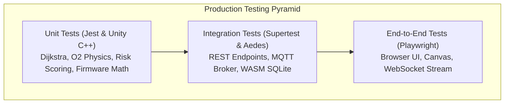
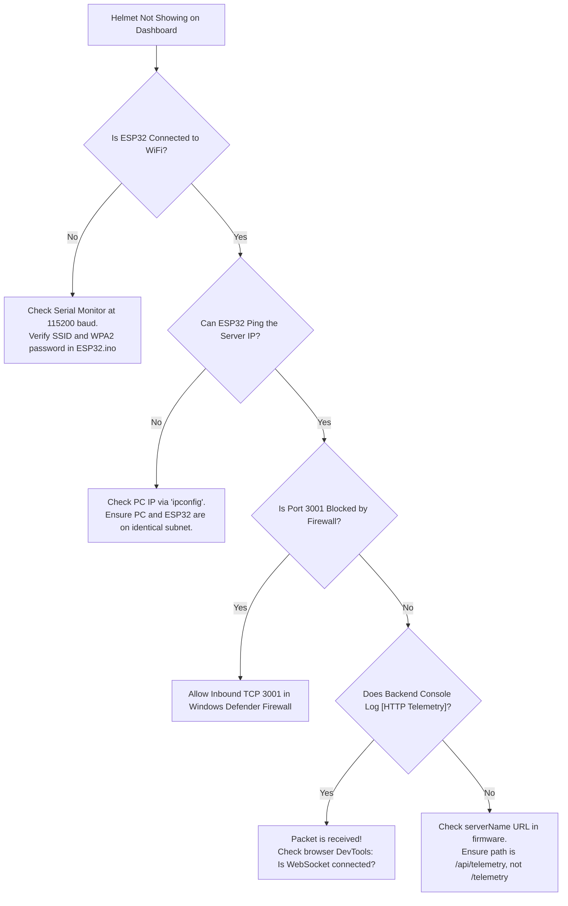

# SafeMine: Testing Strategy, Quality Assurance & Field Debugging Guide

---

## 1. Audit of Existing Testing Strategy

A rigorous inspection of the SafeMine repository reveals a stark engineering reality:

```
+---------------------------------------------------------------------------------------------------+
|                                  TESTING COVERAGE AUDIT SUMMARY                                   |
+---------------------+-------------------+---------------------------------------------------------+
| Test Category       | Current Status    | Implementation Analysis                                 |
+---------------------+-------------------+---------------------------------------------------------+
| Automated Unit Tests| 0% (Non-existent) | No Jest, Mocha, or Vitest test runners configured       |
| API Integration Test| 0% (Non-existent) | No Supertest suites validating Express endpoints        |
| E2E Browser Tests   | 0% (Non-existent) | No Playwright or Cypress specs for UI verification      |
| Firmware Unit Tests | 0% (Non-existent) | No PlatformIO / Unity tests for ESP32 C++ algorithms    |
| Manual Simulation   | PARTIAL (B)       | dummy-engine.js, lora-gateway.js, esp32_simulator.js    |
+---------------------+-------------------+---------------------------------------------------------+
```

### Current Testing Mechanism: Script-Based Manual Simulation
Rather than formal automated test assertions, the project currently relies on manual simulation scripts:
1. **`backend/dummy-engine.js`**: Generates synthetic drift, motion changes, and Zone C methane spikes every 3 seconds for 12 miners.
2. **`backend/esp32_simulator.js`**: Transmits periodic HTTP POST packets to `/api/telemetry` to verify hardware ingest handling.
3. **`backend/lora-gateway.js`**: Publishes synthetic JSON telemetry directly over MQTT topics.
4. **`underground-tracker.html`**: A manual verification dashboard displaying curl commands and hardware checklist steps.

---

## 2. Comprehensive Test Plan

To bring SafeMine to production reliability, an automated testing hierarchy must be established across all system tiers.



---

### A. Unit Testing Plan (Targeting Core Algorithmic Engines)

Unit tests must focus on pure, deterministic business logic without external network or database dependencies.

#### Test Cases for `o2Calculation.js`:
- `TC-O2-01`: Baseline validation. With 0 workers and $0.0\%$ gas, estimated O2 must equal $20.9\% \pm 0.06\%$.
- `TC-O2-02`: Worker respiration cap. With 50 workers, worker drop must cap at exactly $2.5\%$.
- `TC-O2-03`: Gas displacement cap. With $5.0\%$ methane, gas drop must cap at exactly $4.0\%$.
- `TC-O2-04`: Lower bound clamping. Extreme gas and worker counts must never allow O2 to drop below $15.0\%$.
- `TC-O2-05`: Upper bound clamping. O2 must never exceed $21.0\%$.

#### Test Implementation Example (Jest):
```javascript
const { calculateOxygenLevel, getO2Label } = require('../backend/o2Calculation');

describe('Oxygen Calculation Physics Engine', () => {
  test('returns baseline O2 under clean ambient conditions', () => {
    const o2 = calculateOxygenLevel(0, 0);
    expect(o2).toBeGreaterThanOrEqual(20.84);
    expect(o2).toBeLessThanOrEqual(20.96);
    expect(getO2Label(o2)).toBe('SAFE');
  });

  test('applies worker respiration drop correctly', () => {
    // 10 workers * 0.12% = 1.20% drop from 20.9% -> ~19.7%
    const o2 = calculateOxygenLevel(10, 0);
    expect(o2).toBeCloseTo(19.7, 1);
    expect(getO2Label(o2)).toBe('SAFE');
  });

  test('classifies DANGER when O2 drops below 18.0%', () => {
    // 12 workers (drop 1.44) + 1.5% CH4 (drop 1.8) -> total drop 3.24 -> O2 ~17.66%
    const o2 = calculateOxygenLevel(12, 1.5);
    expect(o2).toBeLessThan(18.0);
    expect(getO2Label(o2)).toBe('DANGER');
  });

  test('enforces strict lower clamp of 15.0%', () => {
    const o2 = calculateOxygenLevel(100, 10.0);
    expect(o2).toBe(15.0);
  });
});
```

---

### B. Integration Testing Plan (Targeting Ingestion & Persistence)

Integration tests must validate HTTP routing, parameter clamping, database persistence, and WebSocket broadcasting.

#### Test Implementation Example (Supertest + Jest):
```javascript
const request = require('supertest');
const { app } = require('../backend/server');
const db = require('../backend/db');

describe('Telemetry Ingestion & Range Clamping Integration', () => {
  beforeAll(async () => {
    await db.ready;
  });

  test('POST /api/telemetry clamps impossible methane readings and logs fault', async () => {
    const payload = {
      worker_id: 'MNR-TEST',
      name: 'Test Miner',
      ch4: 99.9, // Impossible reading exceeding CH4_MAX (5.0%)
      temp: 24.0,
      heart_rate: 75
    };

    const res = await request(app)
      .post('/api/telemetry')
      .send(payload)
      .expect(200);

    expect(res.body.ok).toBe(true);

    // Verify worker in DB was clamped to safe fallback
    const worker = db.prepare('SELECT * FROM workers WHERE id = ?').get('MNR-TEST');
    expect(worker.ch4).toBeLessThanOrEqual(5.0);

    // Verify sensor fault record was created
    const fault = db.prepare('SELECT * FROM sensor_faults WHERE worker_id = ? AND sensor = ?')
      .get('MNR-TEST', 'ch4');
    expect(fault).not.toBeNull();
    expect(fault.severity).toBe('critical');
  });
});
```

---

## 3. Comprehensive Field Debugging Guide

The following scenarios detail real-world failure modes and step-by-step diagnostic workflows:

---

### Scenario 1: Physical ESP32 Helmet Is Powered On but Does Not Appear on Dashboard



#### Step-by-Step Diagnostic Commands:
1. **Inspect Serial Monitor**:
   - Connect ESP32 via USB and open serial monitor at 115200 baud.
   - Look for: `[WiFi] Connecting...... Connected! IP: 192.168.1.87`.
   - If HTTP response is `-1` or `0`, the ESP32 cannot reach the backend IP.
2. **Verify Server Binding & LAN IP**:
   - In terminal, execute: `ipconfig` (Windows) or `ifconfig` (Linux). Identify local IPv4 address (e.g. `192.168.1.50`).
   - In `ESP32.ino`, ensure `serverName` matches:
     `const char* serverName = "http://192.168.1.50:3001/api/telemetry";`
3. **Verify Windows Defender Firewall**:
   - Windows frequently blocks inbound connections on non-standard ports (3001).
   - Test connectivity from another machine on the LAN:
     `curl http://192.168.1.50:3001/api/health`
   - If curl hangs or times out, open Windows Firewall $\to$ Inbound Rules $\to$ Add New Rule $\to$ Port TCP 3001 $\to$ Allow.

---

### Scenario 2: Gas Spike Occurs in Zone C, but No Alert Appears on Dashboard

#### Diagnostic Flow:
1. **Verify Ingestion**:
   - Query the backend database:
     `SELECT id, name, ch4, risk FROM workers WHERE zone = 'Zone C';`
   - If `ch4` is still low, the telemetry packet has not reached the database.
2. **Check Alert Deduplication Throttling (`ALERT_TTL_MS`)**:
   - Inspect `server.js` line 894:
     ```javascript
     const alertKey = `${w.id}::${a.level}::${a.title}`;
     if (checkSafetyThresholds._lastAlert[alertKey] && now - checkSafetyThresholds._lastAlert[alertKey] < ALERT_TTL_MS) {
       return; // Suppressed by deduplication!
     }
     ```
   - *Explanation*: SafeMine suppresses repeated identical alerts for 60 seconds (`ALERT_TTL_MS=60000`) to prevent flooding the database every 3 seconds. The alert was logged once upon first threshold crossing, but subsequent duplicate entries are deliberately dropped.
3. **Inspect Browser WebSocket Connection**:
   - Open browser DevTools $\to$ Network tab $\to$ Filter by `WS`.
   - Check connection state to `ws://localhost:3001`.
   - If red/disconnected, check topbar indicator dot (`#ws-status`). If offline, `api.js` is failing reconnection attempts.

---

### Scenario 3: Dijkstra Evacuation Path Routes Directly Through a Hazard Zone

#### Diagnostic Flow:
1. **Verify Geofence Active State**:
   - Query `SELECT id, name, type, active, radius, cx, cy FROM geofences;`
   - If `active = 0`, the geofence is ignored by the optimizer.
   - If `type !== 'hazard'` and `type !== 'machinery'`, the Dijkstra engine will not apply the $+500$ penalty (line 111 of `optimizer.js`).
2. **Inspect Tunnel Graph Geometry**:
   - The penalty calculation checks if the **midpoint** of the tunnel edge lies inside the geofence radius:
     `Math.hypot(mx - gf.cx, my - gf.cy) < gf.radius`
   - If a tunnel edge is very long (e.g. `J-T4` to `J-T6` is 350 units), the hazard geofence might overlap one end of the tunnel while missing the exact mathematical midpoint $(mx, my)$.
   - *Fix*: Subdivide long tunnel edges into smaller intermediate segments, or test point-to-line-segment distance rather than midpoint alone.

---

### Scenario 4: Database Error `EADDRINUSE` or Disk Write Failure on Server Start

#### Diagnostic Flow:
1. **Address In Use (`EADDRINUSE`)**:
   - Occurs when an earlier background Node process was not terminated cleanly.
   - Run in PowerShell:
     ```powershell
     netstat -ano | findstr :3001
     taskkill /PID <PID> /F
     ```
2. **SQLite Database Lock / Corruption (`mineguard.db`)**:
   - If `fs.writeFileSync()` was interrupted mid-write during a power loss or forced process kill, `mineguard.db` may be truncated or corrupted.
   - Run database reset script:
     ```bash
     npm run reset-db
     npm run seed
     npm run patch-gps
     ```
